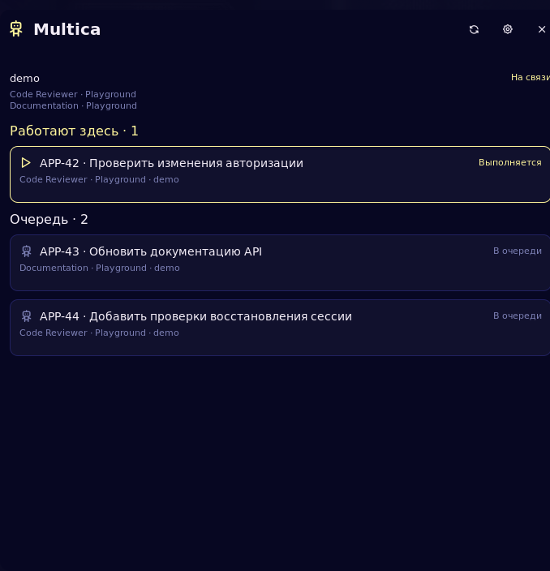
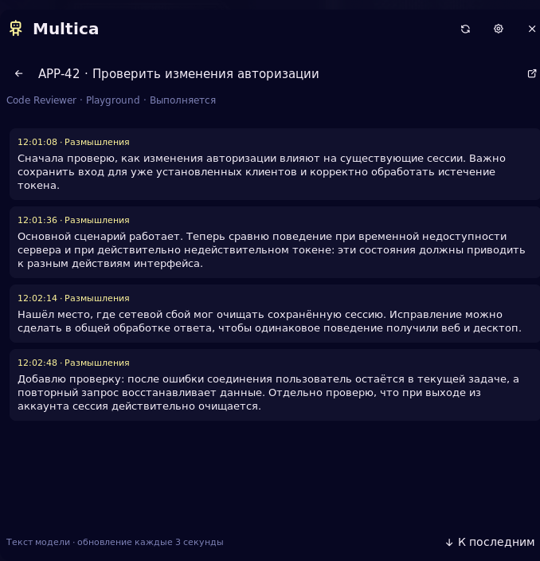

# Multica для Noctalia

Виджет панели для задач Multica, исполняемых на этом компьютере. Требуется Noctalia 5.4+ (plugin API 43), Python 3.10+ и настроенный локальный Multica.

На панели робот и число выполняющихся задач. `2/3` означает две работающие задачи и три в очереди. Значок `!` сообщает об ошибке или неполных данных, `?` — об отсутствии актуального состояния. Нажатие открывает задачи; правая кнопка — настройки.

В панели доступны:

- запущенные задачи, подготовка и ожидание освобождения рабочей папки;
- очередь агентов, привязанных к локальным runtime;
- название задачи, агент, workspace и профиль;
- текст модели и её опубликованные размышления, без вызовов инструментов и их результатов;
- более ранние сообщения, последние завершённые запуски и переход к задаче в Multica.

Задачи обновляются раз в 10 секунд (интервал меняется в настройках), открытый журнал — раз в 3 секунды. Переход к более ранним сообщениям приостанавливает обновление журнала; «К последним» возобновляет его. После завершения выбранной задачи её журнал остаётся открыт.

## Скриншоты

Снимки из Noctalia с демонстрационными задачами и текстом; фон сделан непрозрачным для съёмки.

| Задачи и очередь | Текст модели |
| --- | --- |
|  |  |

## Установка

Из GitHub:

```bash
noctalia msg plugins source add multica git https://github.com/Tr0sT/noctalia-multica-plugin.git
noctalia msg plugins enable tr0st/multica
```

В настройках панели добавить виджет `tr0st/multica:bar`. Либо создать его через IPC и добавить имя `multica` в нужную секцию существующей панели, сохранив остальные элементы:

```bash
noctalia msg config-set widget.multica "{ type = 'tr0st/multica:bar' }"
noctalia msg panel-open tr0st/multica:panel
```

Обновить установленный источник:

```bash
noctalia msg plugins update multica
```

Для разработки вместо Git-источника можно подключить каталог клона командой `noctalia msg plugins source add multica-dev path "$PWD"`. Изменения Luau подхватываются автоматически.

### NixOS / Home Manager

Добавить обновляемый input в `flake.nix`:

```nix
inputs.noctalia-multica-plugin = {
  url = "github:Tr0sT/noctalia-multica-plugin";
  flake = false;
};
```

В модуле Home Manager, которому `inputs` передан через `extraSpecialArgs`:

```nix
{ inputs, lib, pkgs, ... }: {
  home.packages = [ pkgs.python3 pkgs.xdg-utils ];
  xdg.dataFile."noctalia/plugins/multica".source =
    "${inputs.noctalia-multica-plugin}/multica";

  programs.noctalia.settings = {
    plugins.enabled = lib.mkAfter [ "tr0st/multica" ];
    widget.multica.type = "tr0st/multica:bar";
    bar.main.start = lib.mkAfter [ "multica" ]; # Existing bar name
  };
}
```

Локальный каталог данных имеет приоритет над Git- и path-источниками из настроек Noctalia. `nix flake update noctalia-multica-plugin` обновляет версию в lock-файле; после этого применяется обычная конфигурация системы. Ни профили Multica, ни токены в Nix-конфигурацию передавать не нужно.

Отключить плагин:

```bash
noctalia msg plugins disable tr0st/multica
```

Затем удалить `multica` из секции панели в её настройках. Отключение не влияет на Multica и исполняемые задачи.

## Откуда берутся данные

`bridge.py` автоматически обнаруживает основной профиль `~/.multica/config.json` и именованные профили `~/.multica/profiles/*/config.json`. Адрес локального демона берётся из `daemon.port`; проверяются PID и профиль. Если запись устарела, используется стандартный порт профиля Multica с повторной проверкой идентичности.

`GET /health` задаёт локальные workspace/runtime и счётчик реально выполняющихся задач. Через API того же сервера помощник читает workspace, агентов, `/api/agent-task-snapshot`, названия задач и `/api/tasks/{id}/messages?since=...`. Для очереди используется текущий runtime агента, для уже забранных задач — runtime самой задачи. Поэтому перепривязка агента не переносит отображение старого запуска на другой компьютер.

Токены читаются из существующих профилей внутри Python-процесса. В аргументы команд, Luau, общий state плагина или файлы проекта они не попадают. Все запросы — GET. Плагин не запускает, не отменяет и не переназначает задачи. Ошибка одного профиля отображается отдельно и не скрывает доступные данные остальных.

Отображаются сообщения типов `text`, `thinking`, `reasoning`, которые Multica уже сохранила. Соседние фрагменты одного типа объединяются; вызовы инструментов и их результаты отфильтровываются до передачи данных в Noctalia. Счётчик журнала продвигается и через скрытые события.

## Проверки

```bash
python3 -m unittest discover -s tests -v
noctalia plugins lint multica
python3 tests/run_ui_tests.py  # нужен luau в PATH
```

На NixOS Luau можно временно предоставить без изменения системы:

```bash
nix shell nixpkgs#luau --command python3 tests/run_ui_tests.py
```

Проверки охватывают локальную привязку задач, перепривязку агента, ошибки и неполные ответы, идентичность профиля, пагинацию, скрытие инструментов, объединение текста, переключение журнала во время запроса и устаревшие счётчики. Они не запускают агентские CLI.

Ручная диагностика без раскрытия токенов:

```bash
python3 multica/bridge.py snapshot
noctalia msg plugin tr0st/multica:monitor all refresh
noctalia config validate
```

При известном ключе задачи из snapshot можно открыть сразу её журнал:

```bash
noctalia msg panel-open tr0st/multica:panel '<profile>:<task-uuid>'
```

## Границы

- Очередь и журнал требуют доступа к серверу; локальный health сам по себе их не содержит.
- Полный первоначальный журнал считывается API, затем выводится последняя страница. API пока поддерживает только курсор `since`; загрузка старых сообщений повторно читает историю. Ответы больше 32 MiB отклоняются с явной ошибкой.
- В одном направлении хранится до 300 фрагментов. Более ранние доступны кнопкой загрузки. Отдельное сообщение длиннее 16 000 символов показано с отметкой о сокращении и ссылкой на полный текст в Multica.
- «Последние запуски» — последний успешный или неудачный запуск каждого агента из snapshot, до пяти на workspace и десяти в панели; это не полная история.
- Самостоятельные процессы Codex/Claude вне Multica сюда не входят.

Контракт плагинов: [официальная документация Noctalia](https://docs.noctalia.dev/noctalia/plugins/development/).
